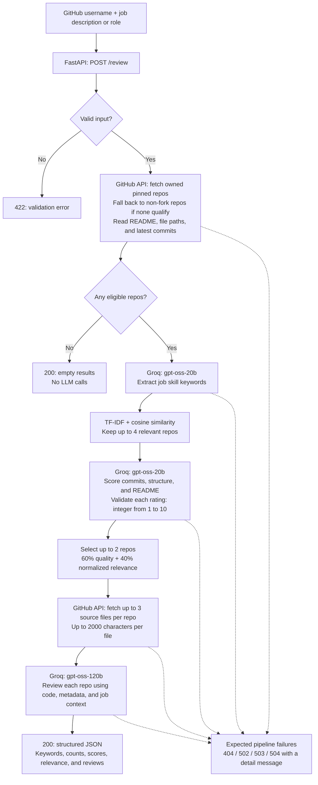

# RecruiterEye

See your GitHub the way a recruiter does, before they do.

Paste a GitHub profile and a job description (or just a job role). RecruiterEye picks your most relevant repos, scores them, and gives you an honest review of what a recruiter would notice and what to fix.

>  Work in progress. I'm building this phase by phase and learning as I go.

## Current status

As of 13 November 2026, the Phase 3 backend is implemented and has completed a
live review using GitHub and Groq. That run fetched 6 repositories, scored 4,
and returned reviews for RecruiterEye and LatentSpace.

- **API tests:** all 32 tests in `tests/test_review_api.py` passed locally.
- **Frontend:** not built yet. `/docs` is Swagger's API testing interface.
- **Next milestone:** a minimal UI with a GitHub username field, job description
  input, loading feedback, review results, and empty/error states.
- **Known limitation:** reviews can make unsupported claims from incomplete
  source samples. Better file selection and evidence-backed findings are deferred
  follow-up work; a successful request does not establish review accuracy.

## Why

I build projects for my resume, but I never know what a recruiter actually sees. Is my commit history real work or a one-shot upload? Is my README clear? Does my repo look like a real project? This tool is the second pair of eyes I wanted.

## How it works

The idea is a funnel: cheap steps first, expensive steps last, on fewer repos.

1. **Fetch** your pinned repos (what a recruiter sees first), falling back to all repos if none are pinned. For each: README, file structure and commits from the GitHub API.
2. **Keywords:** a small LLM turns a job description or job role into skill keywords.
3. **Filter:** TF-IDF ranks repos against those keywords and keeps the best few.
4. **Score:** a small LLM rates each repo on commit history, structure and README.
5. **Review:** a stronger LLM reads the code of the top 1-2 repos and writes the final review.

The pipeline is available through `POST /review`: it scores up to four relevant repos and deeply reviews up to two using the supplied job context. The standalone reviewer example reviews only the first selected repo. The web UI is still pending.

## Architecture flow

The current Phase 3 backend runs the pipeline sequentially within one request.



`backend/routers/review.py` coordinates the pipeline. `backend/github_api/fetch.py`
handles GitHub data, while `backend/agent/` contains keyword extraction, filtering,
scoring, and reviewing. The LLM stages share `backend/agent/llm.py`.
Dotted arrows show failure paths; an upstream failure ends the request without
returning partial reviews. LangGraph, persistence, streaming, and the web UI are
planned for later phases.

## Tech

Python, FastAPI, Groq (gpt-oss models), scikit-learn (TF-IDF), PyGithub.
Planned: LangGraph, PostgreSQL, ChromaDB (RAG), Razorpay (Pro tier), Docker.

## Project structure

```text
recruitereye/
├── backend/
│   ├── main.py          # starts the server
│   ├── core/            # config and secrets
│   ├── github_api/      # talks to GitHub
│   ├── agent/           # llm, keywords, filter, scorer, reviewer
│   ├── routers/         # API endpoints
│   ├── db/              # later
│   └── rag/             # later
├── tests/              # helper, API pipeline, and upstream-error tests
├── .env.example
└── requirements.txt
```

## Roadmap

- [x] Phase 0: project skeleton, `/health` endpoint
- [x] Phase 1: GitHub fetch
- [x] Phase 2: LLM helper and keyword generation
- [x] Phase 3: filter, score, review behind one endpoint, with validation and mocked tests
- [x] Manual live review with GitHub and Groq
- [ ] Next milestone: minimal web UI for the existing backend
- [ ] Phase 4: LangGraph
- [ ] Phase 5: database and streaming
- [ ] Phase 6: RAG with cited guidelines
- [ ] Phase 7: chatbot for follow-up questions
- [ ] Phase 8: web UI, Razorpay, evaluation, Docker

## Future (v2)

- **Resume input:** upload a resume, extract the GitHub links in it, and review those repos too. Repos linked in the resume get a priority boost, since they're the ones the candidate chose to show.
- **Better filter:** replace TF-IDF with a smarter relevance method (for example, embeddings), since word overlap alone is a rough signal.
- **Smarter use of rate limits:** the free tier allows 30 requests/min and 8K tokens/min per model.
  - Trim inputs before sending: cap README length, send only key files, skip lockfiles and binaries.
  - Cache results (for example, keyword output per job role, repo scores per commit) so repeat runs make zero calls.
  - Retry with backoff on rate-limit errors (wait, then try again, longer each time).
  - Pick the model by task: 20b for cheap scoring, 120b only for the final review.
  - Track tokens used per run and spread calls out instead of sending them all at once.

## Setup (Windows CMD)

Run these commands from the project directory. Skip environment creation if the
`recruitereye` Conda environment already exists.

```cmd
cd /d X:\AI-Projects\recruitereye
conda create -n recruitereye python=3.10 -y
conda activate recruitereye
python -m pip install -r requirements.txt
```

If `.env` does not exist, create it with `copy .env.example .env`. Edit it to set
`GITHUB_TOKEN` and `GROQ_API_KEY` to your own credentials; keep the file private.
Then start the server:

```cmd
python -m uvicorn backend.main:app --reload
```

Leave that terminal running. In a second CMD window, check the health endpoint:

```cmd
curl.exe http://127.0.0.1:8000/health
```

Expected response: `{"status":"ok"}`. This checks the app, not GitHub or Groq access.
Press `Ctrl+C` in the server terminal to stop it.

## Review API

With the server running, open `http://127.0.0.1:8000/docs` to try `POST /review`.
Expand the endpoint, click **Try it out**, enter the following request body, and
click **Execute**. Read the actual result under **Server response**, rather than
the documented example under **Responses**.

```json
{
  "username": "SutikshanUpman",
  "job_input": "Backend developer using Python and FastAPI"
}
```

Alternatively, submit the same request from a second Windows CMD window:

```cmd
curl.exe -X POST http://127.0.0.1:8000/review -H "Content-Type: application/json" -d "{\"username\":\"SutikshanUpman\",\"job_input\":\"Backend developer using Python and FastAPI\"}"
```

This makes real GitHub and Groq calls and waits for the full pipeline to finish.
Results and counts can change as repositories and model responses change.

Use a GitHub username, not a profile URL. `job_input` accepts a role or job description
of 1–3000 characters. Both inputs are trimmed and must be nonempty.

The response contains `username`, extracted `keywords`, `repos_fetched`,
`repos_scored`, and `reviews`. Each review includes `name`, `url`, TF-IDF
`relevance`, three integer `scores` from 1–10 (`commit_history`, `structure`,
`readme`), their `total` out of 30, and the detailed `review` text.
Selection combines quality (60%) and normalized relevance (40%).

The code review samples up to 3 source files per repository and up to 2000
characters per file. It is not a whole-repository audit; verify findings against
the repository before acting on them.

Profiles with no eligible repositories return HTTP 200 with empty `keywords` and
`reviews`, and zero counts; no LLM calls are made. Otherwise, the request waits for
the entire pipeline. An upstream failure fails the request rather than returning
partial reviews or treating failed scores as zero.

| Status | Meaning |
| --- | --- |
| 422 | Invalid username or job input |
| 404 | GitHub user or repository not found |
| 502 | Upstream service failure or invalid model response |
| 503 | Missing server configuration, rate limit, or GitHub access unavailable |
| 504 | Upstream request timed out |

Errors include a `detail` message. Missing READMEs and empty repositories are
handled separately from service failures. `/health` remains available without API keys.

## Tests

To run only the API test file in the activated environment:

```cmd
python -B -m pytest tests/test_review_api.py -v -p no:cacheprovider
```

To run the full test suite:

```bash
python -B -m pytest -q -p no:cacheprovider
```

Tests use fake configuration and mocked GitHub/Groq calls; they do not read `.env`
or make network calls. They cover helper functions, the combined pipeline, input
validation, empty profiles, model output validation, and upstream errors.
The local API-file run on 13 November 2026 passed all 32 tests with one
Starlette TestClient deprecation warning. This result applies to that file;
it is not a recorded full-suite result.

A separate manual run with configured credentials returned 6 fetched repos,
4 scored repos, and 2 reviews. It confirmed live integration, while also exposing
incorrect claims about RecruiterEye's request validation and README instructions.
Review quality still needs evaluation.

## Author

**Sutikshan Upman**, B.Tech CSE, IIIT Nagpur
[LinkedIn](https://linkedin.com/in/SutikshanUpman) · [GitHub](https://github.com/SutikshanUpman)


## What needs to be done

Review date: 12 November 2026. Unchecked items are proposed work, not completed changes.

Portfolio priority: complete a small, explainable LLM product.

- [ ] Keep the sequential orchestration in `backend/routers/review.py`; avoid adding orchestration frameworks solely for the technology list.
- [ ] In `backend/github_api/fetch.py`, obtain a repository object once per repo where practical and reuse it across metadata helpers.
- [ ] Replace broad substring exclusions in `backend/agent/reviewer.py::pick_code_files()` with explicit exclusions and a documented priority list for representative source files.
- [ ] Give scoring weights and sampling limits named constants and explain their rationale.
- [x] Document the sampled-source review limits (up to 3 files, 2000 characters per file) and the need to verify findings.
- [ ] Add one complete request/response example, a fixture-based demo, and a small evaluation set checking whether reviews refer to actual evidence.
- [ ] Add a minimal UI for the existing endpoint with clear loading, empty and upstream-error states.
- [ ] Trim the roadmap to immediate deliverables; defer payments, chatbot, RAG and framework rewrites.
- [ ] After changes, run the existing mocked tests and separately record any live-service verification.
