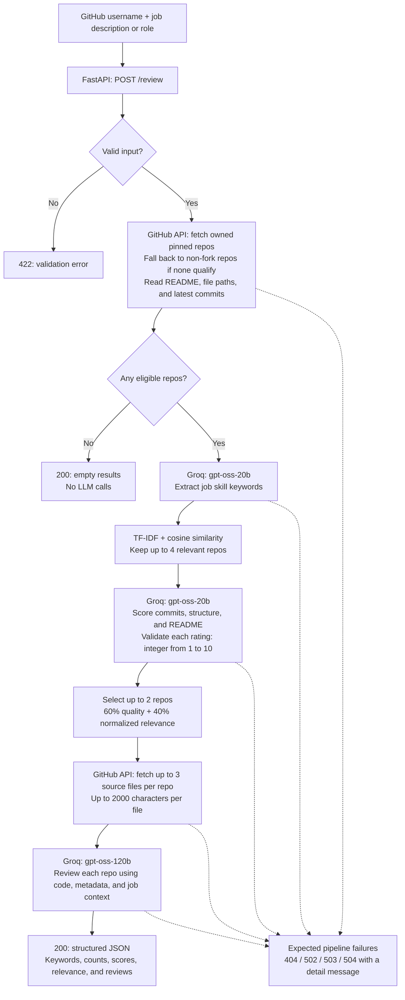

# RecruiterEye

See your GitHub the way a recruiter does, before they do.

Paste a GitHub profile and a job description (or just a job role). RecruiterEye picks your most relevant repos, scores them, and gives you an honest review of what a recruiter would notice and what to fix.

>  Work in progress. I'm building this phase by phase and learning as I go.

## Why

I build projects for my resume, but I never know what a recruiter actually sees. Is my commit history real work or a one-shot upload? Is my README clear? Does my repo look like a real project? This tool is the second pair of eyes I wanted.

## How it works

The idea is a funnel: cheap steps first, expensive steps last, on fewer repos.

1. **Fetch** your pinned repos (what a recruiter sees first), falling back to all repos if none are pinned. For each: README, file structure and commits from the GitHub API.
2. **Keywords:** a small LLM turns a job description or job role into skill keywords.
3. **Filter:** TF-IDF ranks repos against those keywords and keeps the best few.
4. **Score:** a small LLM rates each repo on commit history, structure and README.
5. **Review:** a stronger LLM reads the code of the top 1-2 repos and writes the final review.

The pipeline is available through `POST /review`: it scores up to four relevant repos and deeply reviews up to two using the supplied job context. The standalone reviewer example reviews only the first selected repo. The web UI is still pending.

## Architecture flow

The current Phase 3 backend runs the pipeline sequentially within one request.



`backend/routers/review.py` coordinates the pipeline. `backend/github_api/fetch.py`
handles GitHub data, while `backend/agent/` contains keyword extraction, filtering,
scoring, and reviewing. The LLM stages share `backend/agent/llm.py`.
Dotted arrows show failure paths; an upstream failure ends the request without
returning partial reviews. LangGraph, persistence, streaming, and the web UI are
planned for later phases.

## Tech

Python, FastAPI, Groq (gpt-oss models), scikit-learn (TF-IDF), PyGithub.
Planned: LangGraph, PostgreSQL, ChromaDB (RAG), Razorpay (Pro tier), Docker.

## Project structure

```text
recruitereye/
├── backend/
│   ├── main.py          # starts the server
│   ├── core/            # config and secrets
│   ├── github_api/      # talks to GitHub
│   ├── agent/           # llm, keywords, filter, scorer, reviewer
│   ├── routers/         # API endpoints
│   ├── db/              # later
│   └── rag/             # later
├── tests/              # pure function tests
├── .env.example
└── requirements.txt
```

## Roadmap

- [x] Phase 0: project skeleton, `/health` endpoint
- [x] Phase 1: GitHub fetch
- [x] Phase 2: LLM helper and keyword generation
- [x] Phase 3: filter, score, review behind one endpoint, with validation and mocked tests
- [ ] Phase 4: LangGraph
- [ ] Phase 5: database and streaming
- [ ] Phase 6: RAG with cited guidelines
- [ ] Phase 7: chatbot for follow-up questions
- [ ] Phase 8: web UI, Razorpay, evaluation, Docker

## Future (v2)

- **Resume input:** upload a resume, extract the GitHub links in it, and review those repos too. Repos linked in the resume get a priority boost, since they're the ones the candidate chose to show.
- **Better filter:** replace TF-IDF with a smarter relevance method (for example, embeddings), since word overlap alone is a rough signal.
- **Smarter use of rate limits:** the free tier allows 30 requests/min and 8K tokens/min per model.
  - Trim inputs before sending: cap README length, send only key files, skip lockfiles and binaries.
  - Cache results (for example, keyword output per job role, repo scores per commit) so repeat runs make zero calls.
  - Retry with backoff on rate-limit errors (wait, then try again, longer each time).
  - Pick the model by task: 20b for cheap scoring, 120b only for the final review.
  - Track tokens used per run and spread calls out instead of sending them all at once.

## Setup

```bash
conda create -n recruitereye python=3.10 -y
conda activate recruitereye
pip install -r requirements.txt
cp .env.example .env   # add your GitHub token and Groq key
uvicorn backend.main:app --reload
```

## Review API

With the server running, open `http://127.0.0.1:8000/docs` to try `POST /review`.
Send a JSON body:

```json
{
  "username": "SutikshanUpman",
  "job_input": "Backend developer using Python and FastAPI"
}
```

Use a GitHub username, not a profile URL. `job_input` accepts a role or job description
of 1–3000 characters. Both inputs are trimmed and must be nonempty.

The response contains `username`, extracted `keywords`, `repos_fetched`,
`repos_scored`, and `reviews`. Each review includes `name`, `url`, TF-IDF
`relevance`, three integer `scores` from 1–10 (`commit_history`, `structure`,
`readme`), their `total` out of 30, and the detailed `review` text.
Selection combines quality (60%) and normalized relevance (40%).

Profiles with no eligible repositories return HTTP 200 with empty `keywords` and
`reviews`, and zero counts; no LLM calls are made. Otherwise, the request waits for
the entire pipeline. An upstream failure fails the request rather than returning
partial reviews or treating failed scores as zero.

| Status | Meaning |
| --- | --- |
| 422 | Invalid username or job input |
| 404 | GitHub user or repository not found |
| 502 | Upstream service failure or invalid model response |
| 503 | Missing server configuration, rate limit, or GitHub access unavailable |
| 504 | Upstream request timed out |

Errors include a `detail` message. Missing READMEs and empty repositories are
handled separately from service failures. `/health` remains available without API keys.

## Tests

```bash
python -B -m pytest -q -p no:cacheprovider
```

Tests use fake configuration and mocked GitHub/Groq calls; they do not read `.env`
or make network calls. They cover helper functions, the combined pipeline, input
validation, empty profiles, model output validation, and upstream errors.
Live API behavior and review quality still require a manual run with configured credentials.

## Author

**Sutikshan Upman**, B.Tech CSE, IIIT Nagpur
[LinkedIn](https://linkedin.com/in/SutikshanUpman) · [GitHub](https://github.com/SutikshanUpman)
